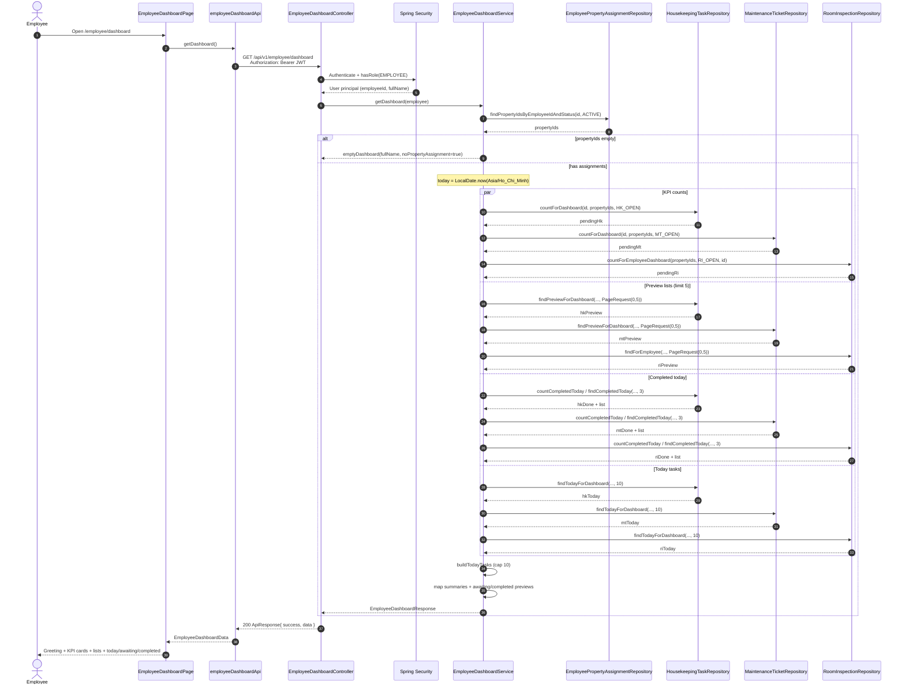
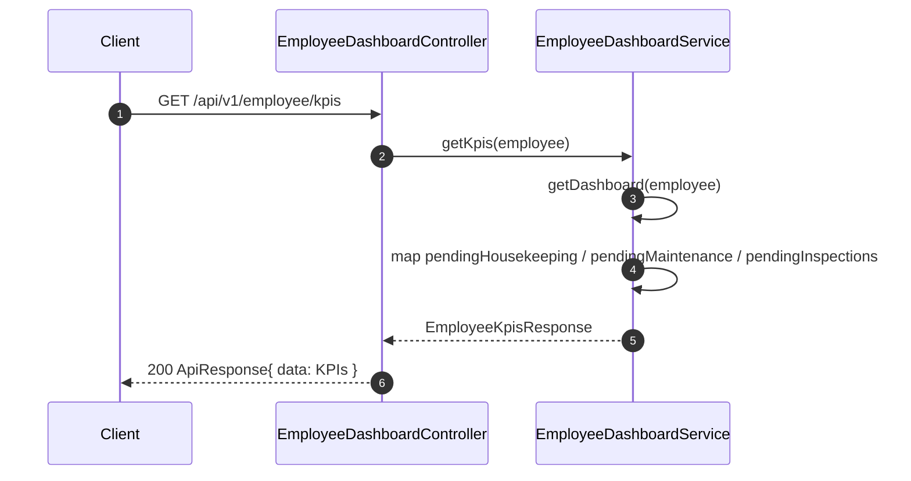
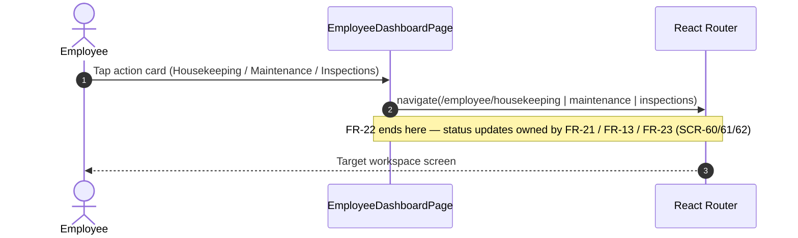

# Detailed Design: FR-22 Employee Dashboard

**Function**: `getEmployeeDashboard` — composite read for SCR-59  
**API**: `GET /api/v1/employee/dashboard`  
**Alias**: `GET /api/v1/employee/kpis` (KPI subset)  
**Spec**: [spec.md](./spec.md) | **Plan**: [plan.md](./plan.md) | **Contract**: [contracts/employee-dashboard-api.yaml](./contracts/employee-dashboard-api.yaml)  
**Boundary**: Read-only aggregate. No SCR-60/61/62 mutations. No new domain tables.

---

## 1. Overview

| Item | Value |
|------|--------|
| Purpose | Aggregate KPI + preview lists + today / awaiting / completed-today for the authenticated EMPLOYEE |
| Actors | Employee (primary); Spring Security (JWT + RBAC) |
| Scope | JWT `employeeId` + FR-20 ACTIVE property IDs; timezone `Asia/Ho_Chi_Minh` |
| Performance | Single round-trip; p95 &lt; 3s (SC-001, SC-007) |
| Envelope | `{ success, message, data: EmployeeDashboardResponse }` |

**Primary flow**: Employee opens `/employee/dashboard` → FE calls composite API → Controller resolves `User` from JWT → Service resolves property scope → Repositories COUNT/LIST → DTO assembly → UI renders greeting, 3 action cards, previews, today/awaiting/completed sections.

---

## 2. Class Diagram

```mermaid
classDiagram
    direction TB

    class EmployeeDashboardController {
        - EmployeeDashboardService employeeDashboardService
        + getDashboard(User currentUser) ResponseEntity~ApiResponse~EmployeeDashboardResponse~~
        + getKpis(User currentUser) ResponseEntity~ApiResponse~EmployeeKpisResponse~~
    }

    class EmployeeDashboardService {
        - ZoneId VN
        - List~HousekeepingTask.Status~ HK_OPEN
        - List~MaintenanceTicket.Status~ MT_OPEN
        - List~RoomInspection.Status~ RI_OPEN
        - HousekeepingTaskRepository housekeepingTaskRepository
        - MaintenanceTicketRepository maintenanceTicketRepository
        - RoomInspectionRepository roomInspectionRepository
        - EmployeePropertyAssignmentRepository employeePropertyAssignmentRepository
        + getDashboard(User employee) EmployeeDashboardResponse
        + getKpis(User employee) EmployeeKpisResponse
        - emptyDashboard(String fullName, boolean noProperty) EmployeeDashboardResponse
        - buildTodayTasks(List, List, List) List~EmployeeTaskSummary~
        - toHkSummary(HousekeepingTask) HousekeepingTaskSummary
        - toMtSummary(MaintenanceTicket) MaintenanceTicketSummary
        - toRiSummary(RoomInspection) RoomInspectionSummary
        - toTask(HousekeepingTask) EmployeeTaskSummary
        - toTask(MaintenanceTicket) EmployeeTaskSummary
        - toTask(RoomInspection) EmployeeTaskSummary
    }

    class EmployeeDashboardResponse {
        + String fullName
        + int pendingHousekeeping
        + int pendingMaintenance
        + int pendingInspections
        + List~HousekeepingTaskSummary~ housekeepingTasks
        + List~MaintenanceTicketSummary~ maintenanceTickets
        + List~RoomInspectionSummary~ inspections
        + List~EmployeeTaskSummary~ todayTasks
        + AwaitingSummary awaiting
        + CompletedTodaySummary completedToday
        + boolean noPropertyAssignment
    }

    class HousekeepingTaskSummary {
        + UUID id
        + String roomNumber
        + String propertyName
        + String status
        + LocalDateTime createdAt
    }

    class MaintenanceTicketSummary {
        + UUID id
        + String title
        + String roomNumber
        + String propertyName
        + String status
        + LocalDateTime createdAt
    }

    class RoomInspectionSummary {
        + UUID id
        + UUID bookingId
        + String roomNumber
        + String propertyName
        + LocalDate checkOutDate
        + String status
    }

    class EmployeeTaskSummary {
        + String type
        + UUID id
        + String roomNumber
        + String propertyName
        + String status
        + String label
        + LocalDate checkOutDate
    }

    class AwaitingSummary {
        + int housekeepingCount
        + int maintenanceCount
        + int inspectionCount
        + List~EmployeeTaskSummary~ previews
    }

    class CompletedTodaySummary {
        + int housekeepingCount
        + int maintenanceCount
        + int inspectionCount
        + List~EmployeeTaskSummary~ previews
    }

    class EmployeeKpisResponse {
        + int pendingHousekeeping
        + int pendingMaintenance
        + int pendingInspections
    }

    class ApiResponse~T~ {
        + boolean success
        + String message
        + T data
        + ok(T data)$ ApiResponse~T~
    }

    class HousekeepingTaskRepository {
        <<interface>>
        + countForDashboard(UUID, List~UUID~, List~Status~) long
        + findPreviewForDashboard(UUID, List~UUID~, List~Status~, Pageable) List~HousekeepingTask~
        + countCompletedToday(UUID, List~UUID~, LocalDateTime, LocalDateTime) long
        + findCompletedToday(UUID, List~UUID~, LocalDateTime, LocalDateTime, Pageable) List~HousekeepingTask~
        + findTodayForDashboard(UUID, List~UUID~, LocalDate, LocalDateTime, LocalDateTime, Pageable) List~HousekeepingTask~
    }

    class MaintenanceTicketRepository {
        <<interface>>
        + countForDashboard(UUID, List~UUID~, List~Status~) long
        + findPreviewForDashboard(UUID, List~UUID~, List~Status~, Pageable) List~MaintenanceTicket~
        + countCompletedToday(UUID, List~UUID~, LocalDateTime, LocalDateTime) long
        + findCompletedToday(UUID, List~UUID~, LocalDateTime, LocalDateTime, Pageable) List~MaintenanceTicket~
        + findTodayForDashboard(UUID, List~UUID~, LocalDateTime, LocalDateTime, Pageable) List~MaintenanceTicket~
    }

    class RoomInspectionRepository {
        <<interface>>
        + countForEmployeeDashboard(List~UUID~, List~Status~, UUID) long
        + findForEmployee(List~UUID~, List~Status~, UUID, Pageable) Page~RoomInspection~
        + countCompletedToday(UUID, List~UUID~, LocalDateTime, LocalDateTime) long
        + findCompletedToday(UUID, List~UUID~, LocalDateTime, LocalDateTime, Pageable) List~RoomInspection~
        + findTodayForDashboard(List~UUID~, UUID, LocalDate, LocalDateTime, LocalDateTime, Pageable) List~RoomInspection~
    }

    class EmployeePropertyAssignmentRepository {
        <<interface>>
        + findPropertyIdsByEmployeeIdAndStatus(UUID, Status) List~UUID~
    }

    class User {
        + UUID id
        + String fullName
        + Role role
    }

    class HousekeepingTask {
        + UUID id
        + Status status
        + User assignedEmployee
        + Room room
        + Property property
        + Booking booking
        + LocalDateTime createdAt
        + LocalDateTime completedAt
    }

    class MaintenanceTicket {
        + UUID id
        + String title
        + Status status
        + User assignedEmployee
        + Room room
        + LocalDateTime createdAt
        + LocalDateTime updatedAt
    }

    class RoomInspection {
        + UUID id
        + Status status
        + User inspectedBy
        + Room room
        + Property property
        + Booking booking
        + LocalDateTime inspectedAt
        + LocalDateTime updatedAt
    }

    EmployeeDashboardController --> EmployeeDashboardService : uses
    EmployeeDashboardController ..> ApiResponse : returns
    EmployeeDashboardController ..> User : JWT principal
    EmployeeDashboardService --> HousekeepingTaskRepository : uses
    EmployeeDashboardService --> MaintenanceTicketRepository : uses
    EmployeeDashboardService --> RoomInspectionRepository : uses
    EmployeeDashboardService --> EmployeePropertyAssignmentRepository : uses
    EmployeeDashboardService ..> EmployeeDashboardResponse : builds
    EmployeeDashboardService ..> EmployeeKpisResponse : builds
    EmployeeDashboardResponse *-- HousekeepingTaskSummary
    EmployeeDashboardResponse *-- MaintenanceTicketSummary
    EmployeeDashboardResponse *-- RoomInspectionSummary
    EmployeeDashboardResponse *-- EmployeeTaskSummary
    EmployeeDashboardResponse *-- AwaitingSummary
    EmployeeDashboardResponse *-- CompletedTodaySummary
    AwaitingSummary *-- EmployeeTaskSummary
    CompletedTodaySummary *-- EmployeeTaskSummary
    HousekeepingTaskRepository ..> HousekeepingTask
    MaintenanceTicketRepository ..> MaintenanceTicket
    RoomInspectionRepository ..> RoomInspection
```



**Package layout (Backend)**

| Layer | Package / type |
|-------|----------------|
| Controller | `com.homestay.controller.EmployeeDashboardController` |
| Service | `com.homestay.service.EmployeeDashboardService` |
| DTO | `com.homestay.dto.response.EmployeeDashboardResponse` (+ nested types), `EmployeeKpisResponse`, `ApiResponse` |
| Repository | `HousekeepingTaskRepository`, `MaintenanceTicketRepository`, `RoomInspectionRepository`, `EmployeePropertyAssignmentRepository` |
| Entity (consumed) | `User`, `HousekeepingTask`, `MaintenanceTicket`, `RoomInspection`, `EmployeePropertyAssignment`, `Booking`, `Room`, `Property` |

---

## 3. Class Specifications

### 3.1 EmployeeDashboardController

| Item | Detail |
|------|--------|
| **Class name** | `EmployeeDashboardController` |
| **Stereotype** | `@RestController` |
| **Responsibility** | Expose EMPLOYEE-only REST endpoints; resolve principal; wrap service result in `ApiResponse` |
| **Base path** | `/api/v1/employee` |
| **Security** | `@PreAuthorize("hasRole('EMPLOYEE')")` |

| Attribute | Type | Description |
|-----------|------|-------------|
| `employeeDashboardService` | `EmployeeDashboardService` | Injected aggregate service |

| Operation | Visibility | Parameters | Returns | Description |
|-----------|------------|------------|---------|-------------|
| `getDashboard` | public | `User currentUser` (`@AuthenticationPrincipal`) | `ResponseEntity<ApiResponse<EmployeeDashboardResponse>>` | `GET /dashboard` — full SCR-59 payload |
| `getKpis` | public | `User currentUser` | `ResponseEntity<ApiResponse<EmployeeKpisResponse>>` | `GET /kpis` — KPI subset alias |

**Constraints**: No business logic; no employeeId query param (always from JWT). Non-EMPLOYEE → 403.

---

### 3.2 EmployeeDashboardService

| Item | Detail |
|------|--------|
| **Class name** | `EmployeeDashboardService` |
| **Stereotype** | `@Service` |
| **Responsibility** | Resolve FR-20 property scope; compute KPIs; load bounded previews; build today / awaiting / completed-today summaries; map entities → DTOs |
| **Transaction** | `@Transactional(readOnly = true)` on public methods |
| **Timezone** | `Asia/Ho_Chi_Minh` for “today” window `[dayStart, dayEnd)` |

| Attribute | Type | Description |
|-----------|------|-------------|
| `VN` | `ZoneId` | Fixed `Asia/Ho_Chi_Minh` |
| `HK_OPEN` | `List<HousekeepingTask.Status>` | `PENDING`, `IN_PROGRESS` |
| `MT_OPEN` | `List<MaintenanceTicket.Status>` | `ASSIGNED`, `IN_PROGRESS` |
| `RI_OPEN` | `List<RoomInspection.Status>` | `PENDING`, `IN_PROGRESS` |
| `housekeepingTaskRepository` | `HousekeepingTaskRepository` | HK counts/lists |
| `maintenanceTicketRepository` | `MaintenanceTicketRepository` | MT counts/lists |
| `roomInspectionRepository` | `RoomInspectionRepository` | RI counts/lists |
| `employeePropertyAssignmentRepository` | `EmployeePropertyAssignmentRepository` | FR-20 scope |

| Operation | Visibility | Parameters | Returns | Description |
|-----------|------------|------------|---------|-------------|
| `getDashboard` | public | `User employee` | `EmployeeDashboardResponse` | Full composite; empty if no ACTIVE properties |
| `getKpis` | public | `User employee` | `EmployeeKpisResponse` | Delegates to `getDashboard`, maps 3 KPI fields |
| `emptyDashboard` | private | `fullName`, `noProperty` | `EmployeeDashboardResponse` | Zeros + empty lists + `noPropertyAssignment` |
| `buildTodayTasks` | private | HK/MT/RI lists | `List<EmployeeTaskSummary>` | Union capped at 10 |
| `toHkSummary` / `toMtSummary` / `toRiSummary` | private | entity | typed summary DTO | Preview row mapping |
| `toTask` (×3 overloads) | private | entity | `EmployeeTaskSummary` | Unified item (`type` + `label`) |

**Business rules (invariants)**

1. All queries filter `employeeId` + `propertyIds` (FR-010).
2. KPI counts from COUNT queries — **not** `previews.length` (KPI ↔ preview consistency).
3. Preview limits: HK/MT/RI = 5; awaiting/completed previews ≤ 3 per type; todayTasks ≤ 10.
4. Completed today: HK `COMPLETED` + `completedAt` in today; MT `RESOLVED` + `updatedAt` in today; RI `PASSED` + `inspectedAt`/`updatedAt` in today.
5. Read-only — no status mutations (FR-012).

---

### 3.3 EmployeeDashboardResponse (+ nested DTOs)

| Class | Responsibility | Key attributes |
|-------|----------------|----------------|
| `EmployeeDashboardResponse` | Aggregate API payload | `fullName`, 3 KPIs, 3 preview lists, `todayTasks`, `awaiting`, `completedToday`, `noPropertyAssignment` |
| `HousekeepingTaskSummary` | HK preview row | `id`, `roomNumber`, `propertyName`, `status`, `createdAt` |
| `MaintenanceTicketSummary` | MT preview row | `id`, `title`, `roomNumber`, `propertyName`, `status`, `createdAt` |
| `RoomInspectionSummary` | RI preview row | `id`, `bookingId`, `roomNumber`, `propertyName`, `checkOutDate`, `status` |
| `EmployeeTaskSummary` | Unified today/awaiting/completed item | `type` ∈ {HOUSEKEEPING, MAINTENANCE, INSPECTION}, `id`, `roomNumber`, `propertyName`, `status`, `label`, `checkOutDate?` |
| `AwaitingSummary` | Pending work section | 3 counts + `previews` (max 9) |
| `CompletedTodaySummary` | Done-today section | 3 counts + `previews` (max 9) |
| `EmployeeKpisResponse` | KPI-only alias | 3 pending integers |

**Stereotype**: Lombok `@Data` `@Builder` response DTOs — no persistence.

---

### 3.4 Repositories (consumed interfaces)

| Repository | Key dashboard operations |
|------------|--------------------------|
| `EmployeePropertyAssignmentRepository` | `findPropertyIdsByEmployeeIdAndStatus(employeeId, ACTIVE)` |
| `HousekeepingTaskRepository` | `countForDashboard`, `findPreviewForDashboard`, `countCompletedToday`, `findCompletedToday`, `findTodayForDashboard` |
| `MaintenanceTicketRepository` | same pattern as HK (status set differs) |
| `RoomInspectionRepository` | `countForEmployeeDashboard`, `findForEmployee`, `countCompletedToday`, `findCompletedToday`, `findTodayForDashboard` |

**Note**: Repositories/entities are owned by FR-21 / FR-13 / FR-23 / FR-20. FR-22 only adds read query methods.

---

### 3.5 Frontend collaborators (SCR-59)

| Type | Responsibility |
|------|----------------|
| `employeeDashboardApi.getDashboard()` | `GET /api/v1/employee/dashboard` via Axios |
| `EmployeeDashboardPage` | Greeting, 3 action cards → SCR-60/61/62, preview sections, empty states |
| `EmployeeLayout` | Shell + nav for employee routes |

---

## 4. Sequence Diagrams

### 4.1 SD-01 — Happy path: Load Employee Dashboard



---

### 4.2 SD-02 — Access denied (non-EMPLOYEE)

```mermaid
sequenceDiagram
    autonumber
    actor Actor as Manager/Customer
    participant API as Client
    participant Ctrl as EmployeeDashboardController
    participant Sec as Spring Security

    Actor->>API: GET /api/v1/employee/dashboard (JWT role ≠ EMPLOYEE)
    API->>Ctrl: request
    Ctrl->>Sec: hasRole('EMPLOYEE')
    Sec-->>Ctrl: AccessDenied
    Ctrl-->>API: 403 Forbidden (DASHBOARD_ACCESS_DENIED)
    Note over API: FE redirects away from SCR-59 (FR-011)
```

---

### 4.3 SD-03 — KPI alias (`GET /employee/kpis`)



---

### 4.4 SD-04 — Navigate from action card (UI only; no write)



---

## 5. Error & empty handling

| Case | HTTP / behavior | Response notes |
|------|-----------------|----------------|
| Missing/invalid JWT | 401 | Unauthorized |
| Role ≠ EMPLOYEE | 403 | Access denied |
| User SUSPENDED | 403 | Blocked by FR-01 before/with dashboard |
| Zero property assignments | 200 | KPIs = 0, empty lists, `noPropertyAssignment = true` |
| Zero pending tasks | 200 | KPIs = 0, empty-state copy on FE |
| Partial repo failure | 5xx | Global exception handler; FE retry |

---

## 6. Traceability

| Design artifact | Spec / SC |
|-----------------|-----------|
| SD-01 happy path | US1–US6, FR-001–FR-010, SC-001, SC-007 |
| KPI fields | FR-003, SC-002 |
| Preview limits 5 | US2, US3, US6 |
| todayTasks | FR-007, US4 |
| awaiting / completedToday | FR-008, US5 |
| `@PreAuthorize EMPLOYEE` | FR-011, SC-004, SD-02 |
| Read-only + nav only | FR-012, SD-04 |
| Empty / no property | FR-013, SC-005 |

---

## 7. Related artifacts

- Spec: `spec.md`
- Data model / query rules: `data-model.md`
- OpenAPI: `contracts/employee-dashboard-api.yaml`
- Research decisions: `research.md`
- Implementation: `EmployeeDashboardController`, `EmployeeDashboardService`, `EmployeeDashboardResponse`
